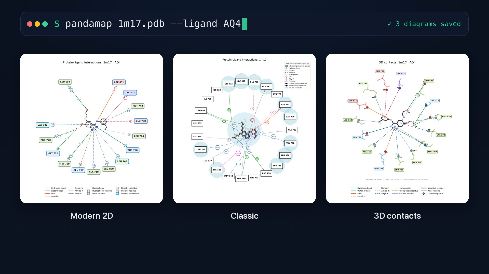
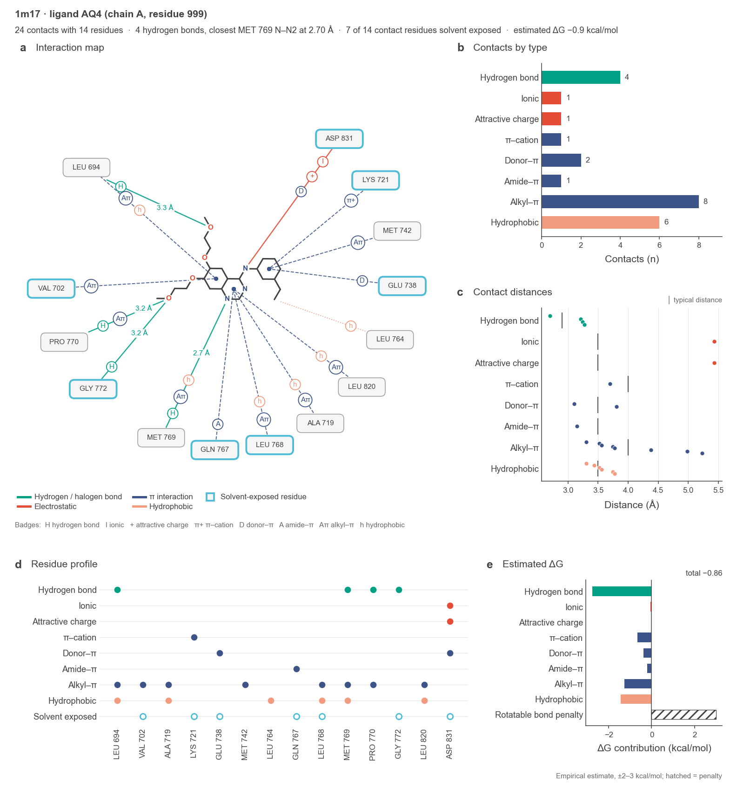
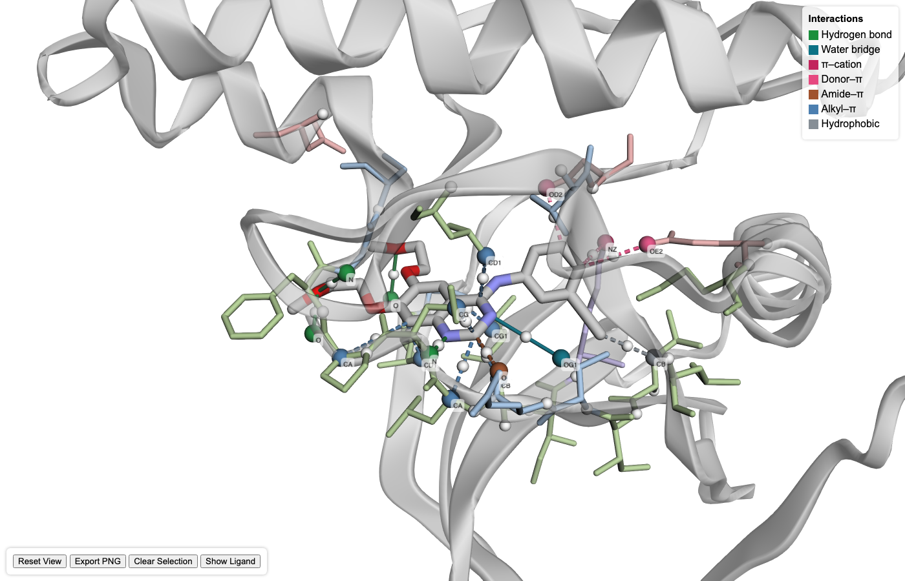

<p align="center">
  
</p>

<p align="center">
  <b>P</b>rotein <b>AND</b> lig<b>A</b>nd interaction <b>MAP</b>per:
  from a structure file to interaction diagrams, reports and data, in one command.
</p>

<p align="center">
  <a href="https://pypi.org/project/pandamap/">
    
  </a>
  <a href="https://github.com/pritampanda15/PandaMap/blob/main/LICENSE">
    
  </a>
  <a href="https://github.com/pritampanda15/PandaMap/stargazers">
    
  </a>
  <a href="https://github.com/pritampanda15/PandaMap/issues">
    
  </a>
  <a href="https://github.com/pritampanda15/PandaMap/network/members">
    
  </a>
  <a href="https://pepy.tech/project/PandaMap">
    
  </a>
</p>

PandaMap reads a protein–ligand complex (PDB, mmCIF or PDBQT), finds the
contacts between the ligand and the protein, and writes figures and tables you
can put straight into a paper or a pipeline. It needs only NumPy, Matplotlib,
BioPython and Requests, and runs from the command line or from Python.

```bash
pip install pandamap
pandamap complex.pdb
```

> **Already have PandaMap installed?** Please use the latest version for
> improved utilization of PandaMap: `pip install --upgrade pandamap`.
> Version 4.4 changes which contacts are reported, adds water bridges, new
> diagrams, JSON and batch mode. See [What's new](#whats-new).

<p align="center">
  <a href="https://github.com/pritampanda15/PandaMap/blob/main/docs/media/pandamap-4.4.mp4">
    
  </a>
  <br>
  <sub>▶ <a href="https://github.com/pritampanda15/PandaMap/blob/main/docs/media/pandamap-4.4.mp4">Watch the 30-second tour</a> (three commands and what they write)</sub>
</p>

That one command writes three diagrams of the same binding site:

| Modern 2D | Classic | 3D contacts |
|:---:|:---:|:---:|
|  |  |  |
| Residues sit next to the ligand atoms they contact | The original PandaMap layout | Which atom of each residue touches the ligand |

<sub>EGFR kinase with erlotinib (PDB 1M17, ligand AQ4). The file is in `example/`, and the
[example gallery](https://github.com/pritampanda15/PandaMap/tree/main/example) shows every output for five structures.</sub>

## Contents

- [Installation](#installation)
- [Quick start](#quick-start)
- [What you get](#what-you-get)
- [Choosing the ligand](#choosing-the-ligand)
- [Command-line reference](#command-line-reference)
- [Python API](#python-api)
- [How interactions are detected](#how-interactions-are-detected)
- [Interaction score](#interaction-score)
- [What's new](#whats-new)
- [Troubleshooting](#troubleshooting)
- [Citation](#citation)

## Installation

```bash
pip install pandamap
```

Python 3.8 or newer. Two optional tools improve the output; PandaMap works
without either:

| Optional | What it adds | Install |
|---|---|---|
| RDKit | Chemically accurate 2D ligand layout (otherwise a projection of the 3D pose) | `conda install -c conda-forge rdkit` or `pip install rdkit` |
| DSSP | More accurate solvent accessibility (otherwise a built-in estimate) | `brew install dssp` (macOS), `sudo apt-get install dssp` (Linux) |

## Quick start

Try it on the example structure in this repository:

```bash
# Three diagrams (modern 2D, classic, 3D contacts)
pandamap example/1m17.pdb --ligand AQ4

# Add a text report and a summary figure
pandamap example/1m17.pdb --ligand AQ4 --report --plots

# Add an interactive 3D viewer you can open in a browser
pandamap example/1m17.pdb --ligand AQ4 --3d

# Export the contacts as data, with the interaction score
pandamap example/1m17.pdb --ligand AQ4 --csv --json --score

# Put everything in one folder, and keep the terminal quiet
pandamap example/1m17.pdb --ligand AQ4 --report --outdir results --quiet

# Batch mode: a folder (or several files) in, two combined tables out
pandamap example/ --outdir screen --diagrams none
```

To see the results without running anything, open the
[example gallery](https://github.com/pritampanda15/PandaMap/tree/main/example).

Not sure what the ligand is called? `pandamap complex.pdb --list-ligands`.
Leave `--ligand` out and PandaMap picks the largest ligand for you.

## What you get

For an input called `1m17.pdb`, files are written to the current directory, or
to the folder given with `--outdir`:

| Option | File | Contents |
|---|---|---|
| *(default)* | `1m17_interactions.png` | Modern 2D diagram |
| *(default)* | `1m17_interactions_classic.png` | Classic diagram |
| *(default)* | `1m17_interactions_3d.png` | 3D contact view |
| `--report` | `1m17_interactions_report.txt` | Text report |
| `--plots` | `1m17_interactions_report.png` | Five-panel summary figure, including the 2D map |
| `--csv` | `1m17_interactions.csv` | One row per contact |
| `--json` | `1m17_interactions.json` | The whole analysis as JSON |
| `--3d` | `1m17_3d_visualization.html` | Interactive 3D viewer |
| `--3d-offline` | `1m17_3d_visualization.html` | The same viewer with 3Dmol.js embedded, for use without internet |
| `--score` | *(printed)* | Empirical interaction score and its breakdown |

Use `-o` to name the main image; its extension sets the format (`.png`,
`.svg`, `.pdf`). Use `--diagrams` to draw only some of the three, for example
`--diagrams modern` or `--diagrams classic 3d`.

### The three diagrams

**Modern 2D.** Each residue is placed beside the part of the ligand it
contacts, so lines stay short. Boxes are coloured by residue type
(hydrophobic, polar, positive, negative), a blue outline marks
solvent-accessible residues, and hydrogen-bond distances are printed. Add
`--show-nearby` to include binding-site residues that make no specific contact.


**Classic.** The original PandaMap diagram: residues evenly spaced on a circle,
with haloes for solvent accessibility.


**3D contacts.** The ligand is drawn as 3D sticks with each contacting residue
as a transparent stick model around it. The residue atom that makes each
contact is a solid sphere labelled with its atom name, for example `CD1` of
LEU 694. Residues are moved outwards so nothing overlaps, so line lengths are
not to scale; the printed distances are the real ones.


### Text report (`--report`)

A header, a summary, one table per interaction type naming the atoms in
contact (closest first), and a per-residue table. Shortened here:

```
==============================================================================
  PandaMap Interaction Report                                 PandaMap 4.4.0
==============================================================================

  Structure      1m17.pdb
  Ligand         AQ4  (chain A, residue 999, 29 heavy atoms)
  Binding site   15 residues in chain A; 8 solvent accessible
  Interactions   19 contacts of 8 types

SUMMARY
------------------------------------------------------------------------------
  Hydrogen bonds           4  ███████████████
  Alkyl-π interactions     8  ██████████████████████████████
  Water bridges            1  ████
  ...

HYDROGEN BONDS (4)
------------------------------------------------------------------------------
   #  Residue    Atom   Ligand atom   Distance  Note
   1  MET 769 A  N      AQ4:N2          2.70 Å
   2  PRO 770 A  O      AQ4:O4          3.21 Å
   3  GLY 772 A  N      AQ4:O4          3.24 Å
   4  LEU 694 A  O      AQ4:O2          3.27 Å

WATER BRIDGES (1)
------------------------------------------------------------------------------
   #  Residue    Atom   Ligand atom   Distance  Note
   1  THR 766 A  OG1    AQ4:N3          3.10 Å  via HOH 10 (2.78 + 3.10 Å)

RESIDUES (15)
------------------------------------------------------------------------------
  Residue    Contacts   Closest  Exposed  Types
  MET 769 A         2    2.70 Å  -        hydrogen bond, alkyl-π
  ASP 831 A         2    3.11 Å  yes      ionic, donor-π
  ...
```

The report is for reading. To load results into another program, use `--csv`
or `--json`.

### Graphical summary (`--plots`)

One figure that explains the binding site at a glance, built around the 2D
interaction map and laid out for publication (183 mm wide, 5–7 pt Arial,
one colour per interaction family in every panel).



| Panel | Shows |
|---|---|
| **a** Interaction map | Which residue touches which part of the ligand, and how |
| **b** Contacts by type | How many contacts of each kind |
| **c** Contact distances | Every contact against the typical distance for its kind |
| **d** Residue profile | Which residue makes which kinds of contact, and which are solvent exposed |
| **e** Interaction score | Contribution of each interaction type to the score; the hatched bar is a penalty |

The line above the panels states the key facts: number of contacts and
residues, the closest hydrogen bond, solvent exposure and the interaction score.
Give `--plots` a `.pdf` or `.svg` path for a vector figure with editable text:

```bash
pandamap example/1m17.pdb --ligand AQ4 --plots figure.pdf
```

### CSV (`--csv`) and JSON (`--json`)

CSV has one row per contact:

```csv
interaction_type,protein_residue,protein_resnum,protein_chain,protein_atom,ligand_atom,ligand_element,distance_A,solvent_accessible,halogen_element
alkyl_pi,ALA,719,A,CB,C19,C,3.31,False,
alkyl_pi,LEU,820,A,CD1,C6,C,3.52,False,
```

JSON holds the whole analysis: the ligand, a summary, every interaction and a
per-residue roll-up. With `--score` it also contains the interaction score
under `interaction_score`.

```json
{
  "pandamap_version": "4.4.0",
  "structure": "1m17.pdb",
  "ligand": {"name": "AQ4", "chain": "A", "number": 999, "n_heavy_atoms": 29},
  "summary": {
    "n_interactions": 19,
    "n_residues": 15,
    "by_type": {"alkyl_pi": 8, "hydrogen_bonds": 4, "water_bridges": 1, "...": "..."}
  },
  "interactions": [
    {
      "type": "alkyl_pi",
      "residue": {"name": "ALA", "number": 719, "chain": "A"},
      "protein_atom": "CB",
      "ligand_atom": "C19",
      "ligand_element": "C",
      "distance": 3.307,
      "solvent_accessible": false
    }
  ],
  "residues": [
    {
      "name": "MET", "number": 769, "chain": "A",
      "solvent_accessible": false,
      "n_contacts": 2,
      "closest_distance": 2.699,
      "types": ["alkyl_pi", "hydrogen_bonds"]
    }
  ]
}
```

### Interactive 3D viewer (`--3d`)

A single HTML file (3Dmol.js) that opens on the binding site. Contacting
residues are pale sticks, contacting atoms are solid labelled spheres (click
one for the residue, atom, interaction type and distance), and the legend lists
only the interaction types present.

By default the page loads 3Dmol.js from the internet when opened. Use
`--3d-offline` to embed the library in the file, so it works without a
connection; PandaMap downloads the library once and caches it.



## Choosing the ligand

- **Automatic.** Without `--ligand`, PandaMap analyses the largest HETATM group
  that is not water, an ion or a common crystallisation additive, and prints
  what it chose and what else is in the file.
- **By name.** `--ligand AQ4` (case-insensitive).
- **Several copies.** If the ligand occurs more than once, the first copy is
  used. Pick another with `--chain B` and/or `--resnum 501`.
- **See the candidates.** `--list-ligands` prints them and exits:

```
Ligand  Chain  Residue  Atoms
HEM     A      301      43
1M2     A      302      11
```

## Command-line reference

```
pandamap <structure_file> [<structure_file> ...] [options]

Positional arguments:
  structure_file          PDB, mmCIF/CIF or PDBQT file. Several files, or a
                          folder, run in batch mode

Ligand:
  -l, --ligand NAME       Residue name of the ligand, case-insensitive (default:
                          auto-detect the largest HETATM group that is not
                          water, an ion or a crystallisation additive)
  --chain ID              Chain of the ligand, when it occurs more than once
  --resnum N              Residue number of the ligand, when it occurs more than once
  --list-ligands          List the candidate ligands in the file and exit

Output location:
  -o, --output FILE       Main image path; the extension selects the format
                          (.png, .svg, .pdf)
  -O, --outdir DIR        Folder for all outputs (created if needed)
  -q, --quiet             Print only warnings and errors

Diagrams:
  -d, --diagrams STYLE [STYLE ...]
                          modern, classic, 3d, all or none (default: all for
                          one structure, modern in batch mode). The first is
                          written to --output; the others get a _classic / _3d
                          suffix
  --show-nearby           Also show binding-site residues that have no specific
                          interaction (modern diagram)
  --no-3d-cues            Disable depth cues in the classic diagram
  --dpi DPI               Image resolution (default: 300)
  -t, --title TEXT        Custom diagram title

Reports and data:
  -r, --report            Plain-text interaction report
  --report-file FILE      Path for the text report
  --plots [FILE]          Five-panel summary figure built around the 2D map
                          (.png, .pdf or .svg)
  --csv [FILE]            Every interaction as a CSV row
  --json [FILE]           The whole analysis as JSON (adds the interaction
                          score when --score is given)
  --score                 Print the empirical interaction score and its
                          breakdown (--deltaG is the older name)

Interactive 3D viewer:
  --3d                    Write the interactive HTML viewer
  --3d-offline            The same, with 3Dmol.js embedded for offline use
  --3d-output FILE        Path for the HTML file
  --width PX, --height PX Viewer size in pixels (default: 800 x 600)
  --no-surface            Hide the protein surface

Detection:
  --strict-halogens       Restrict halogen bonds to Cl/Br/I (see below)
  --strict-hbond-geometry Also apply the heavy-atom angular proxy to
                          structures without explicit hydrogens
  --water-distance-only   Accept water bridges on distances alone (no angle
                          test at the water)

Other:
  --debug                 Print the full traceback when an error occurs
  -v, --version           Show version
  -h, --help              Show help
```

### Batch mode

Give several files or a folder and PandaMap analyses each one, then writes two
combined tables to the output folder (`pandamap_batch` unless `--outdir` is
given):

| File | Contents |
|---|---|
| `batch_summary.csv` | One row per structure: ligand, number of contacts and residues, interaction score, and the count of each interaction type |
| `batch_interactions.csv` | One row per contact, with a `structure` column |

```bash
pandamap docking_poses/ --ligand LIG --outdir screen --diagrams none
```

`--diagrams none` skips the images, which is much faster for screening. Each
structure's own outputs (diagrams, `--report`, `--plots`, `--json`) go into a
sub-folder named after it. A structure that fails is recorded in the summary
with its error, and the run continues.

## Python API

```python
from pandamap import HybridProtLigMapper, list_ligands

print(list_ligands("complex.pdb"))          # what ligands are in the file?

mapper = HybridProtLigMapper("complex.pdb", ligand_resname="LIG")
# one of several copies: HybridProtLigMapper(..., ligand_chain="B", ligand_resnum=501)

# Everything in one call: all three diagrams and the text report
mapper.run_analysis(output_file="site.png", generate_report=True,
                    report_file="site_report.txt")
print(mapper.diagram_files)   # {'modern': 'site.png', 'classic': 'site_classic.png', '3d': 'site_3d.png'}
```

Or step by step:

```python
mapper.detect_interactions()

# One diagram at a time; use a .svg or .pdf path for vector output
mapper.visualize("site.png")                      # modern (default)
mapper.visualize("site_classic.png", style="classic")
mapper.visualize("site_3d.png", style="3d")

# Data
mapper.export_interactions_csv("site.csv")
mapper.export_interactions_json("site.json")
data = mapper.interactions_as_dict()
print(data["summary"]["by_type"])

# Summary figure and interaction score
mapper.generate_interaction_plots("site_report.png")
result = mapper.interaction_score()
print(f"score {result['score']:.2f}: {result['interpretation']}")

# Raw contacts: BioPython atoms and residues
for itype, contacts in mapper.interactions.items():
    for c in contacts:
        print(itype, c["protein_residue"].resname, c["protein_atom"].get_name(),
              c["ligand_atom"].get_name(), round(c["distance"], 2))
```

Interactive 3D viewer:

```python
from pandamap.create_3d_view import create_pandamap_3d_viz

create_pandamap_3d_viz(mapper=mapper, output_file="site_3d.html",
                       width=1024, height=768, show_surface=True)
```

Multi-model files (NMR ensembles, MD frames saved as a multi-MODEL PDB):

```python
from pandamap import analyze_trajectory

summary = analyze_trajectory("frames.pdb", ligand_resname="LIG",
                             output_dir="trajectory_output", frame_step=1)

print(summary["n_frames_analysed"])
print(summary["mean_counts"])      # mean number of contacts per interaction type
print(summary["occupancy"])        # fraction of frames each residue is in contact
print(summary["summary_csv"])      # per-frame table
```

For DCD or XTC trajectories, convert to a multi-model PDB first, for example
`gmx trjconv -f traj.xtc -s topol.tpr -o frames.pdb`.

Many structures at once (the Python form of [batch mode](#batch-mode)):

```python
from pandamap import analyze_batch

result = analyze_batch(["poses/"], output_dir="screen", ligand_resname="LIG",
                       diagrams=())           # no images: fastest
print(result["summary_csv"], result["interactions_csv"])
```

PandaMap prints nothing when used from Python. Its progress messages go to the
`pandamap` logger; to see them:

```python
import logging
logging.basicConfig(level=logging.INFO, format="%(message)s")
```

## How interactions are detected

PandaMap detects 15 interaction classes from distances and, where the
structure allows, angles:

| Interaction | Criterion | Reference |
|---|---|---|
| Hydrogen bond | 2.5–3.5 Å, D–H···A ≥ 100° | PLIP; Auffinger 2004 |
| Water bridge | ligand N/O ··· water ··· protein N/O, or through two waters (ligand ··· water ··· water ··· protein); every leg 2.5–3.5 Å, angle at each water 71–140° (`--water-distance-only` drops the angle test) | PLIP |
| π–π stacking | 5.5 Å (atom–atom) | McGaughey 1998 |
| Hydrophobic | 4.0 Å | Bissantz 2010 |
| Ionic / salt bridge | 5.5 Å | Kumar & Nussinov 1999 |
| Halogen bond | 2.5–3.5 Å | Auffinger 2004 |
| Metal coordination | 2.8 Å | CSD surveys |
| Covalent | 1.2–2.1 Å, non-metal ligand atom | — |
| Repulsion | 4.0 Å | — |

Also detected: cation–π, π–cation, carbon–π, donor–π, amide–π and alkyl–π
contacts.

**Which contacts are reported.**

- *Hydrogen bonds, halogen bonds, metal coordination and covalent bonds* are
  reported per atom pair, so a residue can make more than one: a bidentate
  arginine gives two hydrogen bonds. A pair is dropped only when both of its
  atoms already take part in a shorter contact of the same kind with that
  residue.
- *All other types* describe a group-level contact and are reported once per
  residue, at the closest atom pair.
- *No contact is listed twice.* A charge–charge contact is reported as ionic
  only (it used to appear again as "attractive charge"), and a carbon–carbon
  pair is reported under the most specific class that fits: π–π stacking, then
  alkyl–π, then carbon–π, then hydrophobic.

**Metal ions.** A metal counts as a ligand interaction only when it is within
3 Å of a ligand atom, that is, when it bridges ligand and protein. A
structural metal elsewhere in the protein is ignored.

**Solvent accessibility.** DSSP is used when installed; otherwise a built-in
geometric estimate. The result is the same on every run of the same file.

**Ligand drawing.** Structure files do not store bond orders, so double bonds
and aromatic rings in the diagrams are inferred from the 3D geometry (bond
lengths and ring planarity). The rules are conservative, but treat the drawing
as a readable depiction, not an authoritative assignment. With RDKit installed
the 2D layout comes from RDKit; without it, and for metal complexes such as
heme, the 3D pose is projected and tidied so atoms do not overlap.

### Hydrogen-bond geometry

The angular criterion is applied in two tiers:

- **Explicit hydrogens present** (neutron, ultrahigh-resolution, NMR, or
  protonated models) — the true D–H···A angle is measured in both donor
  directions and must exceed **100°**, matching PLIP's `HBOND_DON_ANGLE_MIN`.
- **No hydrogens** (most X-ray structures) — distance only, as before. A
  heavy-atom angular proxy is available via `--strict-hbond-geometry`, but it
  is off by default: without hydrogens it cannot tell donor from acceptor and
  rejects many genuine bonds.

Each detected bond records `angle` and `angle_source` (`explicit_H` or
`heavy_atom`) so you can tell which rule applied.

### Halogen bonds and fluorine

All four halogens — **F, Cl, Br and I** — are reported by default, matching
PLIP, which also lists C–F···O contacts.

Note for interpretation: organic fluorine has a negligible σ-hole and is not a
halogen-bond donor in the strict sense of Auffinger et al. (2004), which
defines the interaction for Cl, Br and I. Every halogen contact therefore
carries a `halogen_element` field so fluorine can be separated during
analysis, and `--strict-halogens` restricts detection to Cl/Br/I if you want
the conservative definition.

## Interaction score

`--score` (or `mapper.interaction_score()`) sums empirical per-interaction
weights, with one contribution per residue and type, a distance decay, and a
penalty for rotatable bonds:

```
--- Empirical interaction score ---
  Score: 0.29 (kcal/mol scale, not calibrated)
  Breakdown:
    hydrogen_bonds (n=4): -2.77
    alkyl_pi (n=8): -1.26
    ...
    rotatable_bond_penalty (n=6): +3.00
----------------------------------
```

> **This is not a predicted binding free energy.** The weights are literature
> values that have not been fitted to measured affinities, and the sum does
> not track them: the example above is erlotinib bound to EGFR, a nanomolar
> complex, and it scores about zero. Earlier versions called this number ΔG
> and attached Kd labels such as "very weak / no binding expected"; those
> labels are gone. Use the score to compare poses or close analogues of the
> same ligand, and FEP, MM-GBSA or experiment for affinities.

`--deltaG` and `mapper.estimate_binding_affinity()` still work and return the
same number (also under the old key `dG_estimated`).

## What's new

### 4.4.1

- **Two-water bridges**: a ligand linked to a residue through two waters
  (ligand ··· water ··· water ··· protein) is now reported as a water bridge,
  with both waters named, for example `via HOH 6 + HOH 88`.
- **`--water-distance-only`** (`water_angle_check=False` in Python) accepts
  water bridges on hydrogen-bond distances alone, which suits placed or
  3D-RISM waters. The default keeps the PLIP angle test.
- New example: [`example/water_bridge`](example/water_bridge), a complex with
  3D-RISM waters, analysed with and without the angle test.

### 4.4

New:

- **Three diagrams from one run**: a new modern 2D layout, the classic
  diagram, and a new 3D contact view. Choose with `--diagrams`.
- **Summary figure** (`--plots`): five publication-style panels built around
  the 2D interaction map; `.pdf` and `.svg` output keeps the text editable.
- **Redesigned text report** that names the atoms in each contact and adds a
  per-residue table.
- **Water bridges** are detected and shown in every output.
- **Ligand drawing** shows double bonds and aromatic rings, and no longer
  overlaps atoms (heme is drawn as a porphyrin with the iron in the centre).
- **JSON export** (`--json`), **batch mode** (several files or a folder),
  `--outdir` and `--quiet`.
- **Interactive viewer** opens on the binding site, labels contacting atoms,
  lists only the interactions present, and can be made self-contained with
  `--3d-offline`.

Changed results (re-run rather than mixing versions):

- **No contact is counted twice.** "Attractive charge" duplicated every ionic
  contact, and many atom pairs were listed as both alkyl–π and hydrophobic.
  Contact counts drop accordingly (1M17: 24 → 19 including one new water
  bridge).
- **More than one hydrogen bond per residue** is reported when the atoms
  differ (1ELS: 10 → 13).
- **The ΔG estimate is now an "interaction score"** without Kd labels; see
  [Interaction score](#interaction-score).
- **Fixes**: solvent accessibility no longer changes between runs of the same
  file; a metal far from the ligand is no longer reported as a ligand
  interaction; residues with the same number in different chains are no longer
  merged.

Upgrading from 4.3:

- A plain run writes three images instead of one, and the image at the default
  path is the modern diagram. `--diagrams classic` gives the old single output.
- The text report format changed. Scripts that parsed lines such as
  `LEU694A -- 3.27Å -- AQ4` should read the CSV or JSON instead.
- From Python, PandaMap no longer prints progress messages; they go to the
  `pandamap` logger.
- The `attractive_charge` key still exists in `mapper.interactions` but is
  always empty.

### 4.3.1

- Windows: reports, CSV and the 3D page are written as UTF-8, and non-UTF-8
  consoles no longer crash the run.
- Without `--ligand`, one ligand is selected instead of merging every HETATM
  group, waters included.
- `--list-ligands`, `--chain`, `--resnum`, `--debug`; `pandamap --version`
  works on its own; clearer errors for unknown ligands and unreadable files.

<details>
<summary><b>4.3</b>: correctness release (changes detected interactions and ΔG)</summary>

| Change | Description |
|---|---|
| **Halogen bonds now detect Cl, Br and I** | The donor test was case-sensitive against BioPython's upper-cased element symbols (`'BR'`), so only fluorine was ever matched. Bromine, chlorine and iodine halogen bonds were undetectable |
| **No more ΔG double-counting** | Each ionic contact was scored as both `ionic` (−1.80) and `salt_bridge` (−1.50); `cation_pi` and `pi_cation` overlapped and scored one contact twice |
| **Carboxylate salt bridges detected** | Ligand anion perception excluded every carboxylate — the commonest anionic group in drug-like ligands |
| **D–H···A angular criterion** | With explicit hydrogens the true donor angle is measured and must exceed 100° (PLIP's threshold) |
| **Metal coordination no longer scored as covalent** | A Zn–His contact at 2.0 Å was being weighted −8.0 kcal/mol |
| **Readable ligand depiction** | Larger ligands collapsed into an unreadable blob; marker size now tracks bond length |
| **`--csv` and `--plots` outputs** | Machine-readable interaction table and a four-panel graphical report |
| **3D HTML no longer crashes** | `object of type 'Atom' has no len()` on some ligands |
| **Python API report fixed** | `generate_report()` rendered every residue as `UNK??` when passed `mapper.interactions` |
| **Regression test suite** | 18 tests, no external downloads |
| **`--dpi`, `--title`, `--no-3d-cues` now take effect** | All three were accepted by the CLI but never reached the renderer |

Upgrading from 4.2, numbers will change:

- **Ligands containing Cl, Br or I** gain halogen bonds that were previously
  undetectable. On PDB 1US0 this recovers the Br···O(Thr113) bond at 2.97 Å.
- **Ligands with carboxylate, phosphate or sulfonate groups** gain ionic
  contacts that ligand anion perception previously missed.
- **ΔG becomes less negative** for anything with charged groups, because
  ionic contacts are no longer counted twice (−1.80 *and* −1.50). Benchmark
  shifts: 1ELS −21.97 → −18.10, 1M17 −1.43 → −0.86, 1US0 −10.52 → −13.92
  (1US0 becomes *more* negative, since it gains the bromine bond and two
  carboxylate contacts).

If you have published numbers from 4.2, re-run rather than mixing versions.

</details>

<details>
<summary><b>4.2</b></summary>

| Feature | Description |
|---|---|
| **Scientifically validated cutoffs** | H-bond lower bound 2.5 Å, ionic/salt bridge 5.5 Å, halogen lower bound 2.5 Å — aligned with PLIP and crystallographic surveys |
| **RDKit 2D coordinates** | Chemically accurate 2D ligand layout when RDKit is available; PCA projection fallback requires no extra dependencies |
| **Topology-based ring detection** | Iterative leaf-node pruning on the bond graph — identifies rings of any size without SMILES |
| **Exact aromatic atom filtering** | Per-residue ring-atom name sets (PHE/TYR/TRP/HIS) eliminate false π-system contacts from β-carbons |
| **Improved ΔG estimation** | Per-residue deduplication + distance decay + rotatable bond entropy penalty; thermodynamically calibrated Kd labels at 298 K |
| **Trajectory analysis** | Multi-frame PDB/NMR ensemble analysis with per-interaction occupancy statistics and CSV export |
| **Arc stagger in 2D diagram** | Multiple interactions to the same residue fan out with alternating curvature — no marker overlap |
| **`--deltaG` CLI flag** | Estimate binding free energy directly from the command line |

</details>

## Troubleshooting

- **"Ligand 'XXX' not found"**: the message lists the ligands that are in the
  file; or run `--list-ligands`.
- **"No ligand (HETATM) found"**: the ligand must be stored as HETATM records.
  Peptide ligands stored as ATOM records are not supported.
- **Odd characters in a Windows console**: files are always correct UTF-8; the
  console may show `?` for `Å`, `π` or `Δ`. Setting `PYTHONUTF8=1` fixes the
  display.
- **Update notice**: at most once a day PandaMap asks PyPI whether a newer
  version exists and, if so, asks you to upgrade. Set
  `PANDAMAP_NO_UPDATE_CHECK=1` to turn this off.
- **Anything else**: run again with `--debug` for the full traceback and open
  an [issue](https://github.com/pritampanda15/PandaMap/issues).

## Citation

If you use PandaMap in your research, please cite:

```bibtex
@article{Panda2026PandaMap,
  author    = {Panda, Pritam Kumar},
  title     = {PandaMap: A Python Package for Comprehensive Visualization of
               Protein--Ligand Interaction Networks},
  journal   = {bioRxiv},
  year      = {2026},
  doi       = {10.64898/2026.08.06.743421},
  url       = {https://www.biorxiv.org/content/early/2026/08/09/2026.08.06.743421},
  publisher = {Cold Spring Harbor Laboratory}
}
```

## License

MIT. See [LICENSE](LICENSE).
