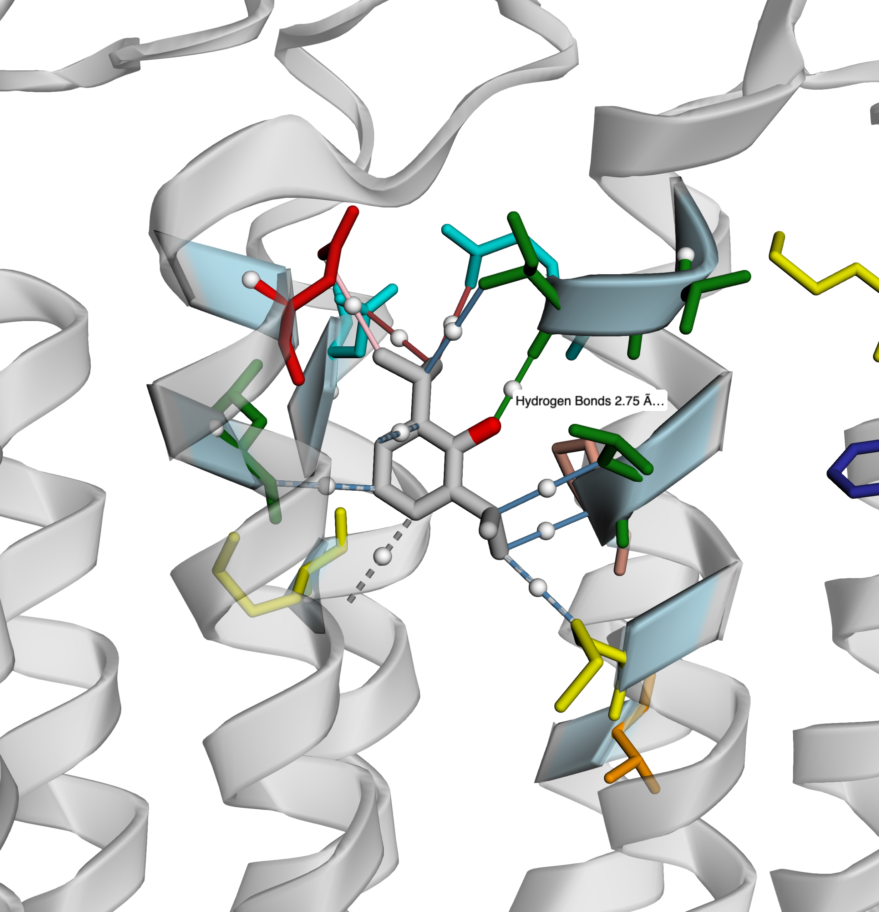
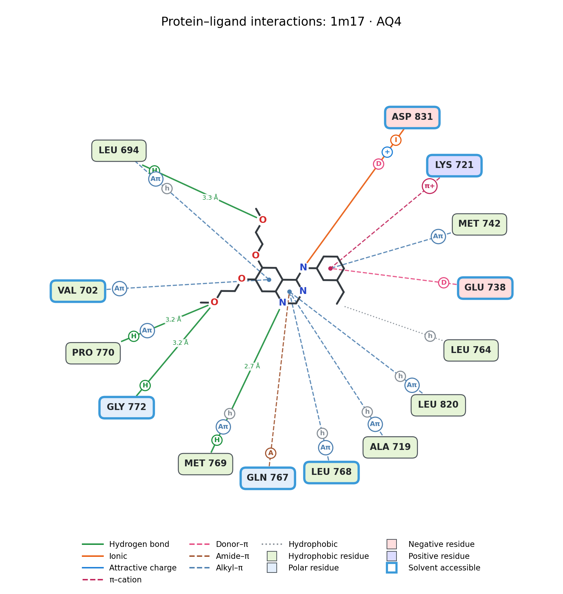
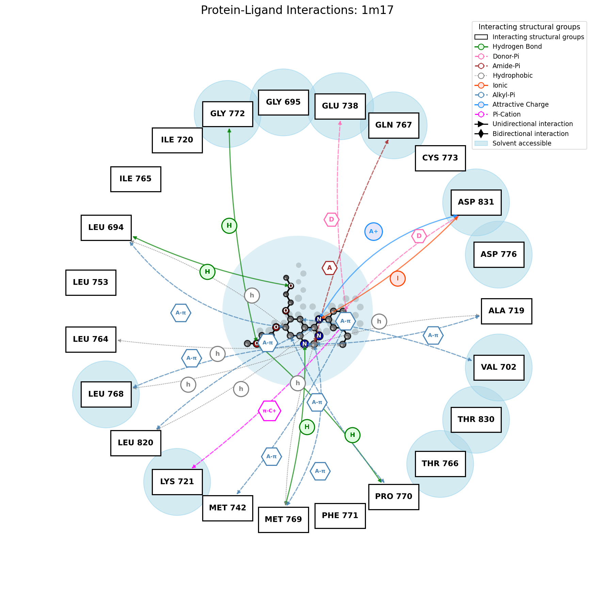
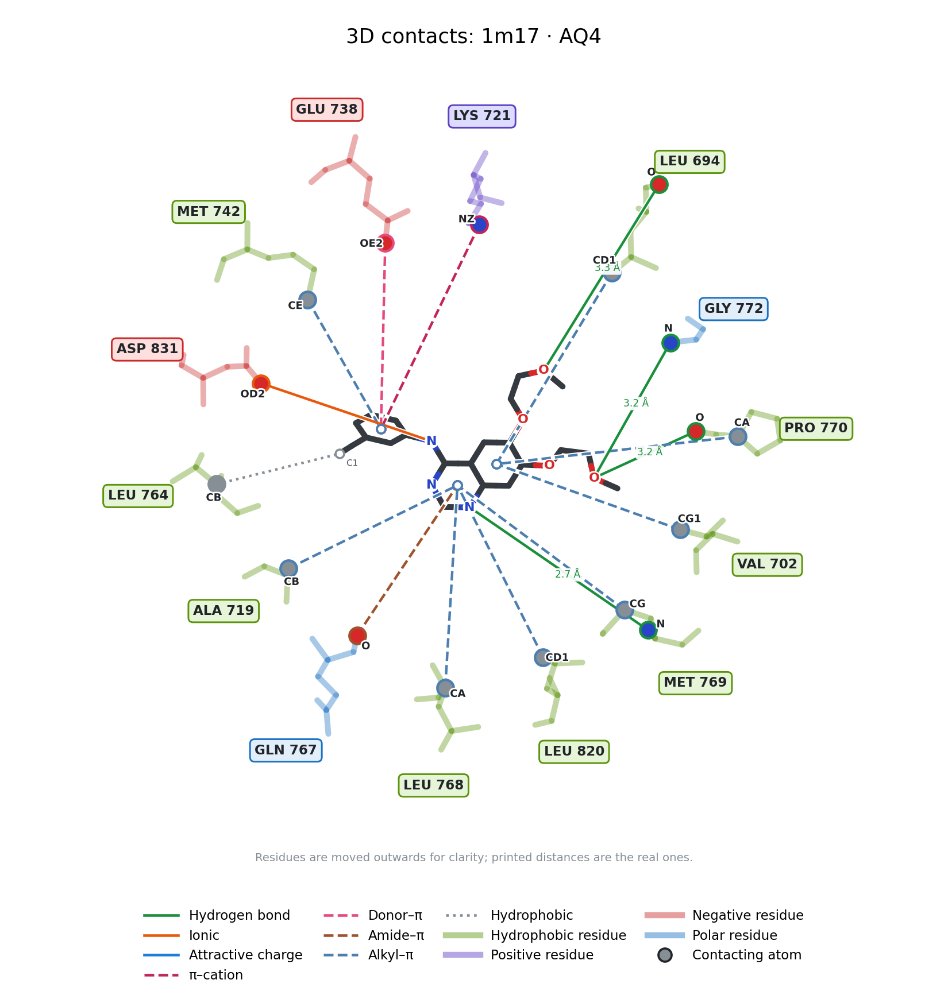
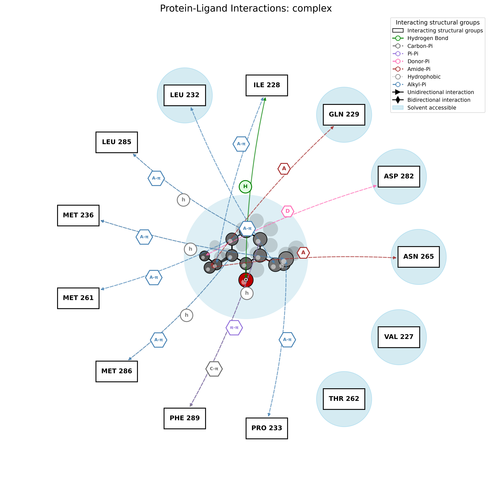
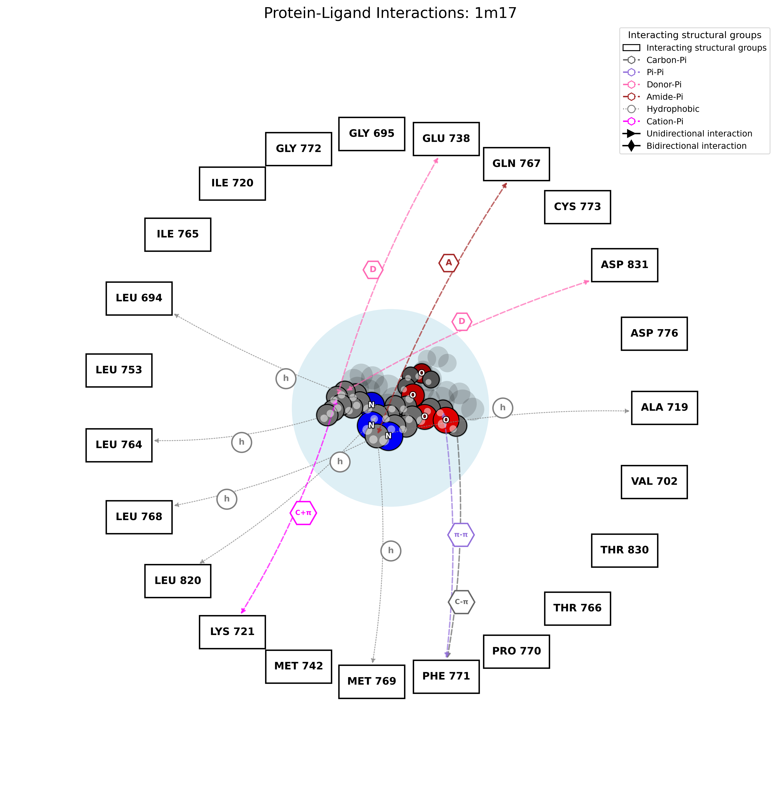
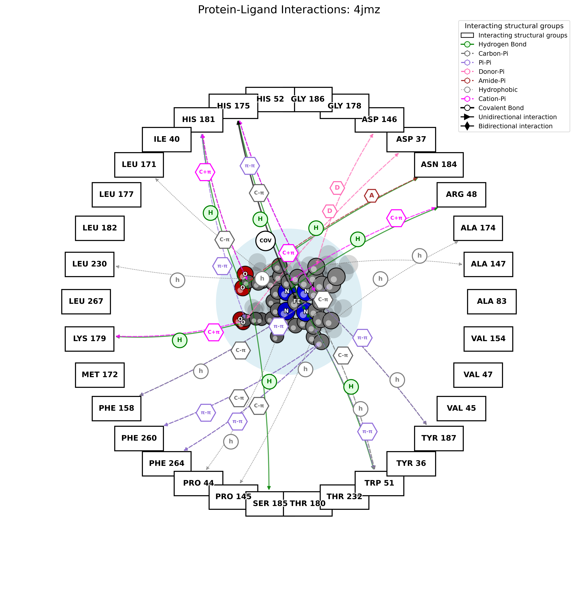
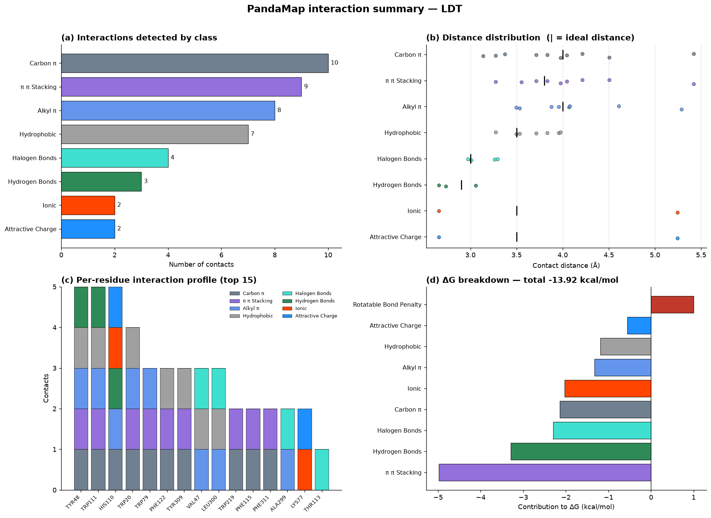

# PandaMap: A Python Package for Visualizing Protein–Ligand Interactions

**P**rotein **AND** lig**A**nd interaction **MAP**per — comprehensive detection, visualization, and empirical binding affinity estimation for protein–ligand complexes.

<p align="center">
  
</p>
<p align="center">
  <a href="https://pypi.org/project/pandamap/">
    
  </a>
  <a href="https://github.com/pritampanda15/PandaMap/blob/main/LICENSE">
    
  </a>
  <a href="https://github.com/pritampanda15/PandaMap/stargazers">
    
  </a>
  <a href="https://github.com/pritampanda15/PandaMap/issues">
    
  </a>
  <a href="https://github.com/pritampanda15/PandaMap/network/members">
    
  </a>
  <a href="https://pepy.tech/project/PandaMap">
    
  </a>
</p>

---

## What's New in v4.3

Correctness release. Several fixes change **which interactions are detected** and
**what ΔG is reported** — see [Upgrading from 4.2](#upgrading-from-42).

| Change | Description |
|---|---|
| **Halogen bonds now detect Cl, Br and I** | The donor test was case-sensitive against BioPython's upper-cased element symbols (`'BR'`), so only fluorine was ever matched. Bromine, chlorine and iodine halogen bonds were undetectable |
| **No more ΔG double-counting** | Each ionic contact was scored as both `ionic` (−1.80) and `salt_bridge` (−1.50); `cation_pi` and `pi_cation` overlapped and scored one contact twice |
| **Carboxylate salt bridges detected** | Ligand anion perception excluded every carboxylate — the commonest anionic group in drug-like ligands |
| **D–H···A angular criterion** | With explicit hydrogens the true donor angle is measured and must exceed 100° (PLIP's threshold) |
| **Metal coordination no longer scored as covalent** | A Zn–His contact at 2.0 Å was being weighted −8.0 kcal/mol |
| **Readable ligand depiction** | Larger ligands collapsed into an unreadable blob; marker size now tracks bond length |
| **`--csv` and `--plots` outputs** | Machine-readable interaction table and a four-panel graphical report |
| **3D HTML no longer crashes** | `object of type 'Atom' has no len()` on some ligands |
| **Python API report fixed** | `generate_report()` rendered every residue as `UNK??` when passed `mapper.interactions` |
| **Regression test suite** | 18 tests, no external downloads |
| **`--dpi`, `--title`, `--no-3d-cues` now take effect** | All three were accepted by the CLI but never reached the renderer |

---

## What's New in v4.2

| Feature | Description |
|---|---|
| **Scientifically validated cutoffs** | H-bond lower bound 2.5 Å, ionic/salt bridge 5.5 Å, halogen lower bound 2.5 Å — aligned with PLIP and crystallographic surveys |
| **RDKit 2D coordinates** | Chemically accurate 2D ligand layout when RDKit is available; PCA projection fallback requires no extra dependencies |
| **Topology-based ring detection** | Iterative leaf-node pruning on the bond graph — identifies rings of any size without SMILES |
| **Exact aromatic atom filtering** | Per-residue ring-atom name sets (PHE/TYR/TRP/HIS) eliminate false π-system contacts from β-carbons |
| **Improved ΔG estimation** | Per-residue deduplication + distance decay + rotatable bond entropy penalty; thermodynamically calibrated Kd labels at 298 K |
| **Trajectory analysis** | Multi-frame PDB/NMR ensemble analysis with per-interaction occupancy statistics and CSV export |
| **Arc stagger in 2D diagram** | Multiple interactions to the same residue fan out with alternating curvature — no marker overlap |
| **`--deltaG` CLI flag** | Estimate binding free energy directly from the command line |

---

## Features

- **15 interaction classes** detected with crystallographically validated distance thresholds:
  - Hydrogen bonds (2.5–3.5 Å, N/O pairs, D–H···A ≥ 100° when hydrogens are present)
  - π–π stacking, cation–π, pi–cation, carbon–π, donor–π, amide–π, alkyl–π
  - Hydrophobic contacts (4.0 Å)
  - Ionic / salt bridge (5.5 Å) — one class; see note below
  - Halogen bonds (2.5–3.5 Å; F, Cl, Br, I)
  - Metal coordination (2.8 Å)
  - Covalent bonds (≤2.1 Å, CYS/SER/LYS/HIS)
  - Attractive and repulsive charge interactions

  > Earlier releases advertised 16 classes by listing `ionic` and `salt_bridge`
  > separately. They share one detection rule and one set of cutoffs, so they
  > are reported as a single class and scored once.

- **Five output formats**: 2D PNG diagram, interactive 3D HTML (3Dmol.js),
  plain-text report, machine-readable CSV (`--csv`), and a four-panel
  graphical report (`--plots`)
- **Empirical ΔG scoring** with per-residue deduplication, distance decay, and rotor penalty
- **Multi-frame trajectory analysis** with occupancy statistics and CSV export
- **Solvent accessibility**: DSSP (preferred) → Shrake–Rupley fallback → geometric fallback
- **Multi-format input**: PDB, mmCIF/CIF, PDBQT (AutoDock Vina)

👉 [Live interactive 3D example](https://github.com/pritampanda15/PandaMap/blob/main/test/complex_3d_visualization.html)



---

## Installation

```bash
pip install pandamap
```

### Optional dependencies

```bash
pip install pandamap[fancy]   # coloured CLI output (rich)
pip install pandamap[viz]     # programmatic 3D viewer (py3Dmol)
pip install pandamap[full]    # all extras
```

### External optional: DSSP (accurate solvent accessibility)

```bash
brew install dssp                          # macOS
sudo apt-get install dssp                  # Linux
# Windows: https://swift.cmbi.umcn.nl/gv/dssp/
```

RDKit (for chemically accurate 2D ligand coordinates):
```bash
conda install -c conda-forge rdkit        # recommended
pip install rdkit                          # pip alternative
```
PandaMap works without RDKit — it falls back to PCA-based 2D projection automatically.

---

## Quick Start

```bash
# 2D interaction diagram
pandamap structure.pdb

# See which ligands the file contains
pandamap complex.pdb --list-ligands

# Specify ligand, generate report and 3D viewer
pandamap complex.pdb --ligand PFL --report --3d

# Estimate binding free energy
pandamap complex.pdb --ligand PFL --deltaG

# Full analysis
pandamap complex.pdb --ligand LIG --report --3d --deltaG --dpi 300
```

---

## Command-Line Reference

```
pandamap <structure_file> [options]

Positional arguments:
  structure_file          Path to PDB, mmCIF/CIF, or PDBQT file

Options:
  -l, --ligand NAME       Residue name of the ligand, case-insensitive (default:
                          auto-detect the largest HETATM group that is not
                          water, an ion or a crystallisation additive)
  --chain ID              Chain of the ligand, when it occurs more than once
  --resnum N              Residue number of the ligand, when it occurs more than once
  --list-ligands          List the candidate ligands in the file and exit
  -o, --output FILE       Output image path; the extension selects the format
                          (.png, .svg, .pdf)
  -r, --report            Generate plain-text interaction report
  --report-file FILE      Path for text report
  --3d                    Generate interactive 3D HTML visualization
  --3d-output FILE        Path for 3D HTML file
  --deltaG                Estimate binding free energy (ΔG, kcal/mol)
  --csv [FILE]            Export every interaction as a tidy CSV
  --json [FILE]           Export the analysis as JSON (ligand, summary, every
                          interaction with its atoms, per-residue roll-up;
                          adds the ΔG estimate when --deltaG is given)
  --plots [FILE]          Four-panel graphical interaction report (PNG)
  --strict-halogens       Restrict halogen bonds to Cl/Br/I (see note below)
  --strict-hbond-geometry Also apply the heavy-atom angular proxy to
                          structures without explicit hydrogens
  --dpi DPI               Output PNG resolution (default: 300)
  -t, --title TEXT        Custom diagram title
  --width PX              3D viewer width in pixels (default: 800)
  --height PX             3D viewer height in pixels (default: 600)
  --no-surface            Hide protein surface in 3D viewer
  -d, --diagrams STYLE [STYLE ...]
                          Which diagrams to draw (default: all):
                            modern   2D, residues placed next to the ligand
                                     atoms they contact, coloured by type
                            classic  the original circular PandaMap diagram
                            3d       transparent residues around the ligand,
                                     each contacting atom highlighted
                          The first is written to --output; the others get a
                          _classic / _3d suffix
  --show-nearby           Also show binding-site residues that have no specific
                          interaction (modern diagram)
  --no-3d-cues            Disable depth cues in the classic diagram
  --debug                 Print the full traceback when an error occurs
  -v, --version           Show version
  -h, --help              Show help
```

---

## Python API

### Single-structure analysis

```python
from pandamap import HybridProtLigMapper

mapper = HybridProtLigMapper("complex.pdb", ligand_resname="LIG")
# Several copies of the ligand?  Pick one:
# mapper = HybridProtLigMapper("complex.pdb", ligand_resname="LIG",
#                              ligand_chain="B", ligand_resnum=501)
# Not sure of the name?  pandamap.list_ligands("complex.pdb")
mapper.detect_interactions()

# One diagram: style is "modern" (default), "classic" or "3d";
# use a .svg or .pdf path for vector output
mapper.visualize(output_file="interactions.png")
mapper.visualize(output_file="interactions_classic.png", style="classic")
mapper.visualize(output_file="interactions_3d.png", style="3d")

# All three at once (also what the command line does by default):
# interactions.png, interactions_classic.png, interactions_3d.png
mapper.run_analysis(output_file="interactions.png")
print(mapper.diagram_files)

# Text report — simplest route, identical output to `pandamap --report`
mapper.run_analysis(output_file="interactions.png",
                    generate_report=True,
                    report_file="report.txt")

# Machine-readable table of every contact
mapper.export_interactions_csv("interactions.csv")

# The same data as JSON, or as a Python dict
mapper.export_interactions_json("interactions.json")
data = mapper.interactions_as_dict()
print(data["summary"]["by_type"])

# Four-panel graphical report
mapper.generate_interaction_plots("report.png")

# Inspect raw interactions
for itype, contacts in mapper.interactions.items():
    if contacts:
        print(f"{itype}: {len(contacts)} contacts")
```

If you need the report generator directly, the parameters are `ligand_info`
and `interactions` (earlier revisions of this README named them
`ligand_metadata` and `interaction_data`, which raises `TypeError`):

```python
from pandamap.improved_interaction_detection import ImprovedInteractionDetection

ImprovedInteractionDetection().generate_report(
    ligand_info={
        'hetid': mapper.ligand_residue.resname,
        'chain': mapper.ligand_residue.parent.id,
        'position': mapper.ligand_residue.id[1],
        'longname': mapper.ligand_residue.resname,
        'type': 'LIGAND',
    },
    interactions=mapper.interactions,
    output_file="report.txt"
)
```

> **Fixed in 4.3.** Passing `mapper.interactions` to `generate_report()`
> previously produced lines reading `UNK?? -- 2.79Å -- SU9`, because the
> formatter expected flattened `restype`/`resnr`/`reschain` keys that only the
> CLI code path filled in. Both paths now normalise their input, so the Python
> API and the CLI produce identical reports.

### Empirical ΔG estimation

```python
result = mapper.estimate_binding_affinity()

print(f"ΔG ≈ {result['dG_estimated']:.2f} kcal/mol")
print(result['interpretation'])
print(result['note'])

for itype, info in result['breakdown'].items():
    print(f"  {itype} (n={info['unique_residues']}): {info['contribution_kcal_mol']:+.2f} kcal/mol")
```

**ΔG interpretation (298 K, ΔG = −RT·ln Kd):**

| ΔG (kcal/mol) | Kd range | Label |
|---|---|---|
| < −12 | ~nM or better | Very strong binder |
| −9 to −12 | nM–µM | Strong binder |
| −6 to −9 | µM | Moderate binder |
| −3 to −6 | mM | Weak binder |
| ≥ −3 | — | Very weak / no binding |

> Note: Empirical estimate ±2–3 kcal/mol. Not a substitute for FEP or MM-GBSA.

### 3D visualization

```python
from pandamap.create_3d_view import create_pandamap_3d_viz

create_pandamap_3d_viz(
    mapper=mapper,
    output_file="interactions_3d.html",
    width=1024,
    height=768,
    show_surface=True
)
```

### Multi-frame trajectory analysis

```python
from pandamap import analyze_trajectory

summary = analyze_trajectory(
    trajectory_file="simulation.pdb",    # multi-MODEL PDB
    ligand_resname="LIG",
    output_dir="./trajectory_output",
    visualize_frames=False               # set True to generate per-frame PNGs
)

print(f"Frames analysed: {summary['n_frames']}")
print(f"Mean ΔG: {summary['mean_dG']:.2f} ± {summary['std_dG']:.2f} kcal/mol")
# Per-residue occupancy CSV written to ./trajectory_output/trajectory_analysis.csv
```

---

## Distance Cutoffs

All cutoffs are validated against PLIP and published crystallographic surveys:

| Interaction | Cutoff | Reference |
|---|---|---|
| Hydrogen bond | 2.5–3.5 Å, D–H···A ≥ 100° | PLIP; Auffinger 2004 |
| π–π stacking | 5.5 Å (atom–atom) | McGaughey 1998 |
| Hydrophobic | 4.0 Å | Bissantz 2010 |
| Ionic / salt bridge | 5.5 Å | Kumar & Nussinov 1999 |
| Halogen bond | 2.5–3.5 Å | Auffinger 2004 |
| Metal coordination | 2.8 Å | CSD surveys |
| Covalent | 1.2–2.1 Å, non-metal ligand atom | — |
| Repulsion | 4.0 Å | — |

### Hydrogen-bond geometry

The angular criterion is applied in two tiers:

- **Explicit hydrogens present** (neutron, ultrahigh-resolution, NMR, or
  protonated models) — the true D–H···A angle is measured in both donor
  directions and must exceed **100°**, matching PLIP's `HBOND_DON_ANGLE_MIN`.
- **No hydrogens** (most X-ray structures) — distance only, as before. A
  heavy-atom angular proxy is available via `--strict-hbond-geometry`, but it
  is off by default: without hydrogens it cannot tell donor from acceptor and
  rejects many genuine bonds.

Each detected bond records `angle` and `angle_source` (`explicit_H` or
`heavy_atom`) so you can tell which rule applied.

### Halogen bonds and fluorine

All four halogens — **F, Cl, Br and I** — are reported by default, matching
PLIP, which also lists C–F···O contacts.

Note for interpretation: organic fluorine has a negligible σ-hole and is not a
halogen-bond donor in the strict sense of Auffinger et al. (2004), which
defines the interaction for Cl, Br and I. Every halogen contact therefore
carries a `halogen_element` field so fluorine can be separated during
analysis, and `--strict-halogens` restricts detection to Cl/Br/I if you want
the conservative definition.

---

## Upgrading from 4.2

Version 4.3 fixes defects that affect reported results. Numbers will change:

- **Ligands containing Cl, Br or I** gain halogen bonds that were previously
  undetectable. On PDB 1US0 this recovers the Br···O(Thr113) bond at 2.97 Å.
- **Ligands with carboxylate, phosphate or sulfonate groups** gain ionic
  contacts that ligand anion perception previously missed.
- **ΔG becomes less negative** for anything with charged groups, because
  ionic contacts are no longer counted twice (−1.80 *and* −1.50). Benchmark
  shifts: 1ELS −21.97 → −18.10, 1M17 −1.43 → −0.86, 1US0 −10.52 → −13.92
  (1US0 becomes *more* negative, since it gains the bromine bond and two
  carboxylate contacts).

If you have published numbers from 4.2, re-run rather than mixing versions.

---

## Example Outputs

### 2D Interaction Diagram

Aldose reductase–IDD594 (PDB 1US0). The halogen bond from the ligand bromine to
Thr113 (cyan, **X**) is one of the contacts recovered by the 4.3 halogen fix;
cyan haloes mark solvent-accessible residues.



PandaMap draws three diagrams of the same interactions. By default the
command line writes all of them; choose with `--diagrams` (for example
`--diagrams modern`, or `--diagrams classic 3d`).

| Diagram | File | What it shows |
|---|---|---|
| `modern` | `<name>_interactions.png` | Each residue sits next to the ligand atoms it contacts; boxes are coloured by residue type, solvent-accessible residues have a blue outline, hydrogen-bond distances are printed |
| `classic` | `<name>_interactions_classic.png` | The original PandaMap diagram: residues evenly spaced on a circle, solvent-accessibility haloes |
| `3d` | `<name>_interactions_3d.png` | The ligand as 3D sticks with every contacting residue as a transparent stick model around it; the residue atom making each contact is a solid sphere labelled with its atom name (for example `CD1` of LEU 694) |

**Classic**



**3D contacts**

In the 3D view the residues are moved straight outwards so nothing overlaps,
which means line lengths are not to scale; the distances printed on the lines
are the real ones.



The interactive viewer (`--3d`) uses the same convention: contacting residues
are translucent and each contacting atom is a solid, labelled sphere.

Further examples:





### Graphical Report (`--plots`)

```bash
pandamap 1US0.pdb --ligand LDT --plots report.png
```



Four panels, complementing the text report rather than replacing it:

| Panel | Shows |
|---|---|
| **(a)** Contacts per class | Which interaction types dominate |
| **(b)** Distance distribution | Every contact against its ideal distance — separates near-optimal geometry from contacts scraping the cutoff |
| **(c)** Per-residue profile | Top 15 residues stacked by interaction class; identifies hotspot residues at a glance |
| **(d)** ΔG breakdown | Per-class contribution, penalties in red |

### CSV Export (`--csv`)

```bash
pandamap 1US0.pdb --ligand LDT --csv interactions.csv
```

One row per contact — the text report is readable but not parseable:

```csv
interaction_type,protein_residue,protein_resnum,protein_chain,protein_atom,ligand_atom,ligand_element,distance_A,solvent_accessible,halogen_element
halogen_bonds,THR,113,A,OG1,BR8,Br,2.97,True,Br
hydrogen_bonds,TYR,48,A,OH,O33,O,2.73,True,
```

### Text Report

Every contact names the residue atom and the ligand atom involved, closest first,
followed by a per-residue table (`pandamap 1els.pdb --ligand PAH --report`):

```
==============================================================================
  PandaMap Interaction Report                                 PandaMap 4.4.0
==============================================================================

  Structure      1els.pdb
  Ligand         PAH  (chain A, residue 439, 9 heavy atoms)
  Binding site   12 residues in chain A; 7 solvent accessible
  Interactions   20 contacts of 6 types

SUMMARY
------------------------------------------------------------------------------
  Hydrogen bonds          10  ██████████████████████████████
  Ionic interactions       2  ██████
  Attractive charges       2  ██████
  Metal coordination       4  ████████████
  Carbon-π interactions    1  ███
  Alkyl-π interactions     1  ███

HYDROGEN BONDS (10)
------------------------------------------------------------------------------
   #  Residue    Atom   Ligand atom   Distance  Note
   1  ASP 246 A  OD2    PAH:O3          2.60 Å
   2  GLU 168 A  OE2    PAH:N3          2.66 Å
   3  SER 375 A  N      PAH:O1P         2.82 Å
   4  ARG 374 A  NH2    PAH:O3P         2.98 Å
   5  LYS 396 A  NZ     PAH:O2          3.05 Å
   6  SER 39 A   OG     PAH:O2P         3.06 Å
   7  GLN 167 A  NE2    PAH:O3          3.10 Å
   8  LYS 345 A  NZ     PAH:O3P         3.21 Å
   9  GLY 37 A   O      PAH:O3P         3.36 Å
  10  ASP 320 A  OD2    PAH:O3          3.46 Å

IONIC INTERACTIONS (2)
------------------------------------------------------------------------------
   #  Residue    Atom   Ligand atom   Distance  Note
   1  ARG 374 A  NH2    PAH:O3P         2.98 Å
   2  LYS 345 A  NZ     PAH:O3P         3.21 Å

ATTRACTIVE CHARGES (2)
------------------------------------------------------------------------------
   #  Residue    Atom   Ligand atom   Distance  Note
   1  ARG 374 A  NH2    PAH:O3P         2.98 Å
   2  LYS 345 A  NZ     PAH:O3P         3.21 Å

METAL COORDINATION (4)
------------------------------------------------------------------------------
   #  Residue    Atom   Ligand atom   Distance  Note
   1  GLY 37 A   O      PAH:MN          2.12 Å
   2  ASP 320 A  OD2    PAH:MN          2.19 Å
   3  ASP 246 A  OD2    PAH:MN          2.24 Å
   4  GLU 295 A  OE2    PAH:MN          2.24 Å

CARBON-π INTERACTIONS (1)
------------------------------------------------------------------------------
   #  Residue    Atom   Ligand atom   Distance  Note
   1  HIS 373 A  CE1    PAH:C2          5.35 Å

ALKYL-π INTERACTIONS (1)
------------------------------------------------------------------------------
   #  Residue    Atom   Ligand atom   Distance  Note
   1  HIS 373 A  CE1    PAH:C2          5.35 Å

RESIDUES (12)
------------------------------------------------------------------------------
  Residue    Contacts   Closest  Exposed  Types
  ARG 374 A         3    2.98 Å  -        hydrogen bond, ionic, attractive charge
  LYS 345 A         3    3.21 Å  -        hydrogen bond, ionic, attractive charge
  GLY 37 A          2    2.12 Å  -        hydrogen bond, metal
  ASP 320 A         2    2.19 Å  yes      hydrogen bond, metal
  ASP 246 A         2    2.24 Å  yes      hydrogen bond, metal
  HIS 373 A         2    5.35 Å  -        carbon-π, alkyl-π
  GLU 295 A         1    2.24 Å  yes      metal
  GLU 168 A         1    2.66 Å  yes      hydrogen bond
  SER 375 A         1    2.82 Å  yes      hydrogen bond
  LYS 396 A         1    3.05 Å  -        hydrogen bond
  SER 39 A          1    3.06 Å  yes      hydrogen bond
  GLN 167 A         1    3.10 Å  yes      hydrogen bond

==============================================================================
  Distances are between the named atoms, in Å. Residues are written as
  NAME NUMBER CHAIN. Exposed = solvent accessible. For a table you can
  load into other tools, use --csv.
==============================================================================
```

### JSON

`--json` writes the same analysis for use in other programs (shortened here):

```json
{
  "pandamap_version": "4.4.0",
  "structure": "1els.pdb",
  "ligand": {
    "name": "PAH",
    "chain": "A",
    "number": 439,
    "n_heavy_atoms": 9
  },
  "summary": {
    "n_interactions": 20,
    "n_residues": 12,
    "by_type": {
      "alkyl_pi": 1,
      "attractive_charge": 2,
      "carbon_pi": 1,
      "hydrogen_bonds": 10,
      "ionic": 2,
      "metal_coordination": 4
    }
  },
  "interactions": [
    {
      "type": "alkyl_pi",
      "residue": {
        "name": "HIS",
        "number": 373,
        "chain": "A"
      },
      "protein_atom": "CE1",
      "ligand_atom": "C2",
      "ligand_element": "C",
      "distance": 5.347,
      "solvent_accessible": false
    },
    "..."
  ],
  "residues": [
    {
      "name": "ARG",
      "number": 374,
      "chain": "A",
      "solvent_accessible": false,
      "n_contacts": 3,
      "closest_distance": 2.982,
      "types": [
        "attractive_charge",
        "hydrogen_bonds",
        "ionic"
      ]
    },
    "..."
  ]
}
```

### ΔG Estimation Output

```
--- Estimated Binding Affinity ---
  ΔG ≈ -7.42 kcal/mol
  Strong binder (Kd ~nM–µM range)
  Breakdown:
    hydrogen_bonds (n=10): -8.63 kcal/mol
    metal_coordination (n=4): -6.80 kcal/mol
    ionic (n=2): -2.91 kcal/mol
    hydrophobic (n=3): -0.72 kcal/mol
    rotatable_bond_penalty (n=2): +1.00 kcal/mol
----------------------------------
```

---

## Citation

If you use PandaMap in your research, please cite:

```
@article {Panda2026.08.06.743421,
	author = {Panda, Pritam Kumar},
	title = {PandaMap: A Python Package for Comprehensive Visualization of Protein{\textendash}Ligand Interaction Networks},
	elocation-id = {2026.08.06.743421},
	year = {2026},
	doi = {10.64898/2026.08.06.743421},
	publisher = {Cold Spring Harbor Laboratory},
	abstract = {Protein{\textendash}ligand interaction diagrams are a routine part of structural and medicinal chemistry, but the tools that produce them tend to force a choice: comprehensive detection with tabular output, publication-quality figures behind a licence, or a scripting environment that assumes expertise. PandaMap (Protein AND ligAnd interaction MAPper) is an open-source Python package that produces a 2D interaction diagram, an interactive 3D viewer, a text report, a machine-readable CSV, and a four-panel graphical summary from a single command. It reads PDB, mmCIF and PDBQT files, detects 15 interaction classes using crystallographically validated distance thresholds, and depends only on NumPy, Matplotlib, BioPython and Requests; RDKit improves the 2D ligand layout when present but is not required. Hydrogen bonds are filtered on the true D{\textendash}H{\textperiodcentered} {\textperiodcentered} {\textperiodcentered} A angle when the structure contains explicit hydrogens, matching PLIP{\textquoteright}s 100{\textopenbullet} criterion on the same evidence, and on distance alone otherwise, with the provenance of each measurement recorded. We benchmarked the package on three complexes chosen for different chemistry: enolase with a phosphonate transition-state analogue (PDB 1ELS), the EGFR kinase with erlotinib (1M17), and aldose reductase with IDD594 (1US0). PandaMap recovers the contacts these structures are known for, including the EGFR hinge hydrogen bond to MET769 and the IDD594 bromine{\textperiodcentered} {\textperiodcentered} {\textperiodcentered} THR113 halogen bond, both at distances identical to PLIP{\textquoteright}s. All detection thresholds, scoring weights and the exact commands used are given in the Supplementary Information, and the release carries a regression suite covering each interaction class. PandaMap 4.3.0 is available on PyPI under the MIT licence.Competing Interest StatementThe authors have declared no competing interest.},
	URL = {https://www.biorxiv.org/content/early/2026/08/09/2026.08.06.743421},
	eprint = {https://www.biorxiv.org/content/early/2026/08/09/2026.08.06.743421.full.pdf},
	journal = {bioRxiv}
}
```

---

## License

MIT License — see [LICENSE](LICENSE) for details.
